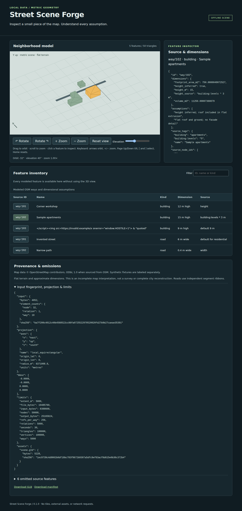

# Street Scene Forge

Turn a **local, bounded OpenStreetMap XML extract** into a dimensioned GLB, a
provenance manifest, and an interactive preview that opens directly from disk.
Python standard library only. No tiles, textures, API calls, or browser CDN.



This is a deliberately small map interpreter: simple buildings become closed
flat-roof extrusions, and selected roads become flat segment ribbons. Every
inferred height/width is labeled. Unsupported or out-of-bounds features appear
in the manifest's diagnostics. It is **not a survey or complete city model**.

## Run offline

Requires Python 3.11+ on Linux (tested with 3.12.3). From this checkout:

```sh
python3 -m street_scene_forge fixtures/synthetic.osm \
  --bbox -0.0009 -0.0009 0.0009 0.0009 --output /tmp/my-neighborhood
```

Open `/tmp/my-neighborhood/index.html` in Chromium. The directory must not exist;
its parent must exist. `--bbox` always means **west south east north**, in degrees.
The example is explicitly **synthetic**, with invented geometry near 0°, 0°.
The hostile-looking feature name is an intentional inert-text security fixture.

Install a self-contained executable without pip or network access:

```sh
python3 scripts/install.py --prefix /tmp/forge-installed
/tmp/forge-installed/bin/street-scene-forge fixtures/berlin-six-ways.osm \
  --bbox 13.4032566 52.5188549 13.4079007 52.5221983 \
  --output /tmp/berlin-scene
```

These six selected real ways form a small example, **not a complete area**.
Their data is © OpenStreetMap contributors, ODbL 1.0; see
[fixture provenance and redistribution](fixtures/README.md).
The verification command uses the exact bbox in the provenance JSON.

## Inspect the output

| File | Purpose |
| --- | --- |
| `scene.glb` | glTF 2.0 binary: one indexed mesh/node per supported way, in metres |
| `manifest.json` | Schema version 1; input SHA-256, projection, limits, IDs, tags, dimensions, assumptions, bounds, omissions, GLB hash |
| `index.html` | Offline interactive inspector and keyboard-accessible feature table |
| `preview.js`, `style.css`, `data.js` | Bundled viewer and data; no external assets |

The preview **decodes the exported GLB**. Drag to orbit, scroll to zoom, and click
a feature to inspect its source. Buttons, canvas keyboard controls, and table
buttons offer the same selection path. The filter searches names, IDs, and kinds.
Arrows orbit/tilt, +/− zoom, Page Up/Down tilt, brackets cycle features, Home resets.

The preview uses a Canvas 2D orthographic painter, with 3D projection and triangle
picking. It has no GPU dependency. Painter ordering is approximate where surfaces
intersect; use the table and GLB for geometric inspection. Ground grid lines are
visual guides, not a survey grid or fixed-size scale bar.

## Input and geometry contract

See [the full contract](docs/CONTRACT.md), including all limits and diagnostics.

- UTF-8 OSM 0.6 XML, local regular file, at most 8 MiB; no DTDs or entities.
- Explicit extent at most 5 km per side, between 85°S and 85°N, no date-line crossing.
- Simple, closed building ways; no holes, building parts, or multipolygons.
- Height: metric `height`, otherwise `building:levels × 3 m`, otherwise 9 m.
  Levels/default values are inferences, not measurements. Unsupported units or
  invalid explicit dimensions omit the feature rather than silently defaulting.
- Roads: selected `highway` ways; metric `width` or documented per-class defaults.
  Independent butt-ended segment rectangles; no junction reconstruction.
- Whole-feature inclusion. Buildings must fit entirely; road ribbons, including
  their width, must fit too. No clipping. Bridges, tunnels, nonzero layers,
  elevation-tagged features, and other elevation-dependent structures are omitted.
- Local spherical equirectangular projection; **X east, Y up, Z south**.
  Buildings start at Y=0; road surfaces are at Y=0.02 m for display separation.

Sorting and serialization are deterministic within the tested environment.
Reversing a building's winding yields the same GLB; reordering source XML changes
its fingerprint but not the geometry. Cross-platform/libm byte identity has not
been established.

## Verify

Conversion and preview need no third-party packages. The **development checks**
use pinned `gltf-validator@2.0.0-dev.3.10` and `playwright@1.64.0`. Install these
once, with network access, before the offline verification:

```sh
npm ci --ignore-scripts --cache /tmp/street-forge-npm
PLAYWRIGHT_BROWSERS_PATH=/tmp/street-forge-browsers \
  node node_modules/playwright/cli.js install chromium
```

Linux browser system libraries and `/usr/bin/time` are needed. They were available
in the tested environment. No package installation happens during verification.

One verification command:

```sh
python3 scripts/verify.py
```

This reruns unit and seeded geometric checks, installs the CLI in a temporary
prefix, executes it from an isolated working directory with a tested socket-denying
Python audit hook, validates GLBs with Khronos, independently decodes geometry,
compares repeated outputs, and exercises Chromium with networking disabled.
It checks synthetic, real, empty, and generated 1,000-building inputs, recording
runtime, per-process peak RSS, asset sizes/hashes, warnings, and browser results
in [`results/`](results/README.md). To keep the recorded evidence unchanged, pass
`--results /tmp/forge-verification`.

The browser test needs its downloaded browser cache. `PLAYWRIGHT_BROWSERS_PATH`
can override its location; the documented `/tmp/street-forge-browsers` is detected
automatically when present. `FORGE_CHROMIUM` can point at another executable,
but that makes the recorded browser version different from the pinned setup.

Quick geometry/contract tests without Node or Chromium:

```sh
python3 -m unittest discover -v
```

## Limits and known omissions

Flat terrain, approximate map dimensions, no textured roofs/facades, lanes,
curbs, signs, trees, courtyards, multipolygons, or terrain fitting. Buildings can
overlap; roads can overlap or leave gaps at bends. Tags not used by the input
contract remain visible as source text but do not change geometry. Heights do
not establish real-world accuracy, even when explicitly tagged.

The independent checks cover 240 seeded concave building/road cases and 80 seeded
invalid/missing-reference cases and 64 seeded boundary groups, plus contract, resource, precision,
cancellation, and output-lifecycle checks. This is not an exhaustive proof for
all OSM data. **No game-engine import, physical-world comparison, human usability
study, screen-reader audit, macOS/Windows run, or browser other than Chromium was
performed.** Abrupt SIGKILL, power failure, or an adversarial local filesystem
writer can leave partial output; handled failures and SIGINT/SIGTERM are cleaned
up. Runtime enforcement with a hard alarm is supported on Unix CLI invocations.

## Existing work and licensing

[OSM2World](https://osm2world.org/) is an established, substantially broader OSM
3D converter. This project makes no novelty claim or quality/performance
comparison with it. [Source review notes](docs/SOURCES.md) explain the conservative
scope and link the OSM and glTF conventions used here.

Code: [MIT](LICENSE). Synthetic fixtures: CC0-1.0. Real OSM fixture: ODbL-1.0,
© OpenStreetMap contributors; code licensing does not relicense map data.
