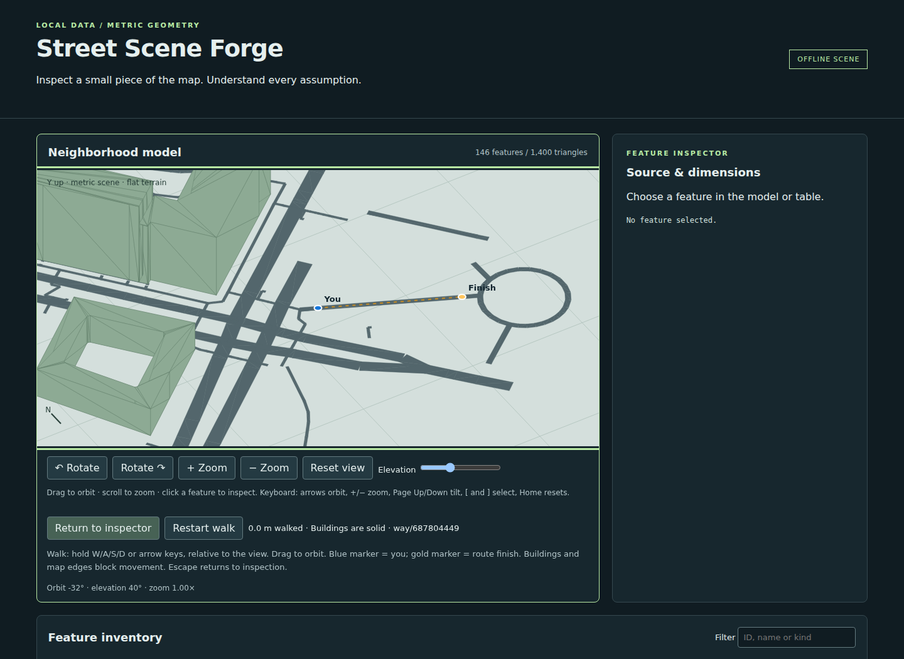
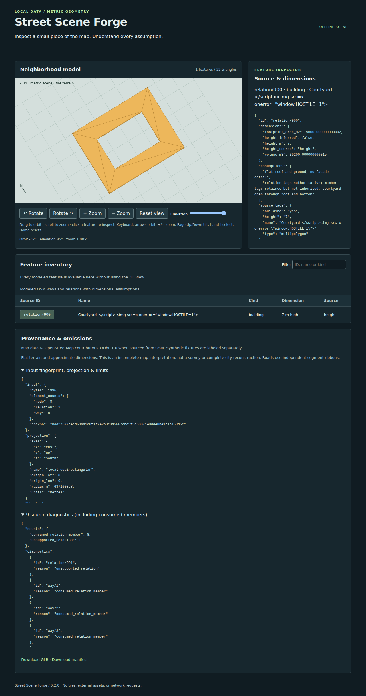

# Street Scene Forge

Turn a **bounded real OpenStreetMap neighborhood into a playable browser scene**,
with a dimensioned GLB, building collisions, and inspectable source provenance.
Python standard library plus a bundled ISC-licensed triangulator; no runtime
installation, tiles, textures, API calls, or browser CDN.



## Play Berlin — one command

Requires Python 3.11+ and a desktop Chromium browser. From this checkout:

```sh
python3 scripts/demo.py
```

This generates the pinned Berlin neighborhood, starts a server on **127.0.0.1**
with an available port, and opens the walk. If a browser does not open, use the
printed URL. Ctrl+C stops the server and removes its temporary output. Add
`--no-browser` for a headless host or `--port 8000` for a fixed local port.
No network acquisition or package installation occurs during launch.

You can also open [`demo/berlin/index.html`](demo/berlin/index.html) directly in
Chromium, then choose **Walk neighborhood**. This checked-in portable demo
includes its licensed extract, acquisition record, GLB, and all browser assets.

- Hold **W/A/S/D or arrows** to move relative to the view, at 5 m/s.
- **Drag** to orbit; scroll or +/− to zoom. The camera follows the blue player.
- Follow the gold dashed route to **Finish**. The included route is about 75 m
  along a real mapped footway (`way/687804449`) near Berlin's Lustgarten.
- Walk toward a building: movement stops/slides along its footprint, and the
  status names the blocking OSM feature. Map boundaries also block movement.
- **Restart walk** returns to the start; **Escape** returns to the source inspector.
  Focus loss clears held movement. Click the canvas to resume keyboard control.

The view is an orthographic 3D model with a ground-plane player marker, not a
first-person engine. Markers and the route are drawn over geometry for visibility.
The player is a 0.45 m radius disc. Collision uses the exported building bottom-cap
triangles (including courtyard holes), with swept movement to prevent tunneling.
There is no jumping, terrain, interior access, door logic, traffic, or road-only
restriction. Omitted buildings and unsupported structures cannot block movement.
On other extracts a route may not exist; a bounded free-space search supplies a
spawn when possible, otherwise walking is explicitly unavailable.

## Reproduce the real workflow

The included **real** snapshot was retrieved on 2026-10-19 UTC from Overpass;
its bbox is `13.403 52.519 13.4075 52.522` (west south east north). It produces
146 supported features (12 buildings, 134 road/path ways), with 1,400 triangles.
It is a conservative interpretation, **not a complete reconstruction**. The
1,030 diagnostics include unsupported tagged nodes, out-of-bounds features,
building parts, and relation-member handling; inspect the manifest for details.
Data: © OpenStreetMap contributors, ODbL 1.0. See
[the acquisition record](fixtures/berlin-neighborhood.provenance.json) and
[fixture licensing](fixtures/README.md).

```sh
python3 -m street_scene_forge fixtures/berlin-neighborhood.osm \
  --bbox 13.403 52.519 13.4075 52.522 \
  --provenance fixtures/berlin-neighborhood.provenance.json \
  --output /tmp/berlin-playable
```

Open `/tmp/berlin-playable/index.html`, choose Walk neighborhood, and traverse the
route. The optional provenance JSON must match the input SHA-256 and exact bbox;
source metadata and the original extract travel with the output. Acquisition
claims are recorded, not independently authenticated by the converter.

To export the same portable demo with one command:

```sh
python3 scripts/demo.py --export /tmp/berlin-portable
```

For a **new online snapshot**, run
`python3 scripts/acquire_neighborhood.py --output /tmp/new-berlin-snapshot`.
It makes one bounded Overpass request, recursively includes dependencies, strips
contributor account metadata, and records hashes, query, bounds and UTC time.
Live OSM changes; reproducibility uses the committed snapshot, not redownloading.
The helper is intentionally separate from the offline converter and launcher.

The renderer supports building ways and bounded multipolygon relations as closed
flat-roof extrusions with open courtyards, and selected roads as segment ribbons.
Every inferred height/width is labeled. Unsupported or out-of-bounds features
appear in diagnostics. It is **not a survey or complete city model**.

## Run offline

Requires Python 3.11+ on Linux (tested with 3.12.3). From this checkout:

```sh
python3 -m street_scene_forge fixtures/synthetic.osm \
  --bbox -0.0009 -0.0009 0.0009 0.0009 --output /tmp/my-neighborhood
```

Open `/tmp/my-neighborhood/index.html` in Chromium. The directory must not exist;
its parent must exist. `--bbox` always means **west south east north**, in degrees.
The example is explicitly **synthetic**, with invented geometry near 0°, 0°.
The hostile-looking feature name is an intentional inert-text security fixture.

Install a self-contained executable without pip or network access:

```sh
python3 scripts/install.py --prefix /tmp/forge-installed
/tmp/forge-installed/bin/street-scene-forge fixtures/berlin-six-ways.osm \
  --bbox 13.4032566 52.5188549 13.4079007 52.5221983 \
  --output /tmp/berlin-scene
```

These six selected real ways form a small example, **not a complete area**.
Their data is © OpenStreetMap contributors, ODbL 1.0; see
[fixture provenance and redistribution](fixtures/README.md).
The verification command uses the exact bbox in the provenance JSON.

## Courtyard example

```sh
python3 -m street_scene_forge fixtures/courtyard.osm \
  --bbox -0.001 -0.001 0.001 0.001 --output /tmp/courtyard-scene
```

Open the preview, select `relation/900`, and raise Elevation to 85° to look into
the courtyard. The inspector shows relation tags, member IDs/tags, assembled
rings, and height assumptions. The courtyard is open through both caps; walls
face the empty space. Consumed ways appear in diagnostics and are not duplicate
buildings. This example is synthetic and includes an inert hostile name.



## Inspect the output

| File | Purpose |
| --- | --- |
| `scene.glb` | glTF 2.0 binary: one indexed mesh/node per supported way or relation, in metres |
| `manifest.json` | Schema version 2; input SHA-256, projection, limits, IDs, tags, dimensions, assumptions, bounds, omissions, GLB hash |
| `index.html` | Offline interactive inspector and keyboard-accessible feature table |
| `preview.js`, `player.js`, `style.css`, `data.js` | Bundled viewer and data; no external assets |

The preview **decodes the exported GLB**. Drag to orbit, scroll to zoom, and click
a feature to inspect its source. Buttons, canvas keyboard controls, and table
buttons offer the same selection path. The filter searches names, IDs, and kinds.
Arrows orbit/tilt, +/− zoom, Page Up/Down tilt, brackets cycle features, Home resets.

The preview uses a Canvas 2D orthographic painter, with 3D projection and triangle
picking. It has no GPU dependency. Painter ordering is approximate where surfaces
intersect; use the table and GLB for geometric inspection. Ground grid lines are
visual guides, not a survey grid or fixed-size scale bar.

## Input and geometry contract

See [the full contract](docs/CONTRACT.md), including all limits and diagnostics.

- UTF-8 OSM 0.6 XML, local regular file, at most 8 MiB; no DTDs or entities.
- Explicit extent at most 5 km per side, between 85°S and 85°N, no date-line crossing.
- Simple closed building ways and building multipolygons with fragmented rings,
  disconnected outers and strictly contained courtyard holes. No building parts,
  touching rings, nesting or legacy outer-tag inheritance.
- Height: metric `height`, otherwise `building:levels × 3 m`, otherwise 9 m.
  Levels/default values are inferences, not measurements. Unsupported units or
  invalid explicit dimensions omit the feature rather than silently defaulting.
- Roads: selected `highway` ways; metric `width` or documented per-class defaults.
  Independent butt-ended segment rectangles; no junction reconstruction.
- Whole-feature inclusion. Buildings must fit entirely; road ribbons, including
  their width, must fit too. No clipping. Bridges, tunnels, nonzero layers,
  elevation-tagged features, and other elevation-dependent structures are omitted.
- Local spherical equirectangular projection; **X east, Y up, Z south**.
  Buildings start at Y=0; road surfaces are at Y=0.02 m for display separation.

Sorting and serialization are deterministic within the tested environment.
Reversing a building's winding yields the same GLB; reordering source XML changes
its fingerprint but not the geometry. Cross-platform/libm byte identity has not
been established.

## Verify

The playable workflow has a focused repeatable check (after installing the
verification dependencies below):

```sh
python3 scripts/verify_playable.py --results /tmp/forge-playable-results
```

It regenerates the real snapshot, verifies source hashes and byte-for-byte packaged
demo correspondence, validates the GLB, tests collision edge cases, launches the
loopback command, and drives Chromium offline through the route and into a
building using real keyboard events. It records four screenshots and JSON results.
[Recorded browser evidence](results/playable/browser.json) and
[collision screenshot](results/playable/berlin-collision.png) accompany the demo.


Conversion and preview need no third-party packages. The **development checks**
use pinned `gltf-validator@2.0.0-dev.3.10`, `playwright@1.64.0`, and
Shapely/GEOS as an independent geometry oracle. Install these
once, with network access, before the offline verification:

```sh
python3 -m pip install -r requirements-verification.txt
npm ci --ignore-scripts --cache /tmp/street-forge-npm
PLAYWRIGHT_BROWSERS_PATH=/tmp/street-forge-browsers \
  node node_modules/playwright/cli.js install chromium
```

Linux browser system libraries and `/usr/bin/time` are needed. They were available
in the tested environment. No package installation happens during verification.

One verification command:

```sh
python3 scripts/verify.py
```

This reruns unit and seeded geometric checks, installs the CLI in a temporary
prefix, executes it from an isolated working directory with a tested socket-denying
Python audit hook, validates GLBs with Khronos, independently decodes geometry,
compares repeated outputs, and exercises Chromium with networking disabled.
It checks the original four workloads, a courtyard example, 100 generated
courtyard buildings, and four pinned upstream fixtures, recording
runtime, per-process peak RSS, asset sizes/hashes, warnings, and browser results
in [`results/multipolygons/`](results/multipolygons/README.md), preserving the
original evidence in `results/`. To keep the recorded evidence unchanged, pass
`--results /tmp/forge-verification`.

The browser test needs its downloaded browser cache. `PLAYWRIGHT_BROWSERS_PATH`
can override its location; the documented `/tmp/street-forge-browsers` is detected
automatically when present. `FORGE_CHROMIUM` can point at another executable,
but that makes the recorded browser version different from the pinned setup.

For a directory-based validation installation (used in the recorded Linux run):

```sh
python3 -m pip install --target /tmp/forge-validation-deps -r requirements-verification.txt
PYTHONPATH=/tmp/forge-validation-deps python3 scripts/verify.py
```

Quick geometry/contract tests with Shapely, without Node or Chromium:

```sh
python3 -m unittest discover -v
```

## Limits and known omissions

Flat terrain, approximate map dimensions, no textured roofs/facades, lanes,
curbs, signs, trees, complex building relations, or terrain fitting. Buildings can
overlap; roads can overlap or leave gaps at bends. Tags not used by the input
contract remain visible as source text but do not change geometry. Heights do
not establish real-world accuracy, even when explicitly tagged.

The independent checks add 250 seeded multipolygon GEOS comparisons, 32 exact
relation boundary cases, 64 seeded invalid relations, four licensed upstream
regressions and relation
resource/lifecycle tests. They retain 240 seeded concave building/road cases and 80 seeded
invalid/missing-reference cases and 64 seeded boundary groups, plus contract, resource, precision,
cancellation, and output-lifecycle checks. This is not an exhaustive proof for
all OSM data. **No game-engine import, physical-world comparison, human usability
study, screen-reader audit, macOS/Windows run, or browser other than Chromium was
performed.** Abrupt SIGKILL, power failure, or an adversarial local filesystem
writer can leave partial output; handled failures and SIGINT/SIGTERM are cleaned
up. Runtime enforcement with a hard alarm is supported on Unix CLI invocations.

## Existing work and licensing

[OSM2World](https://osm2world.org/) is an established, substantially broader OSM
3D converter. This project makes no novelty claim or quality/performance
comparison with it. [Source review notes](docs/SOURCES.md) explain the conservative
scope and link the OSM and glTF conventions used here.

Code: [MIT](LICENSE); bundled Earcut: ISC. Synthetic fixtures: CC0-1.0.
Upstream OSM2World regression fixtures: MIT. Real OSM fixture: ODbL-1.0,
© OpenStreetMap contributors; code licensing does not relicense map data.
